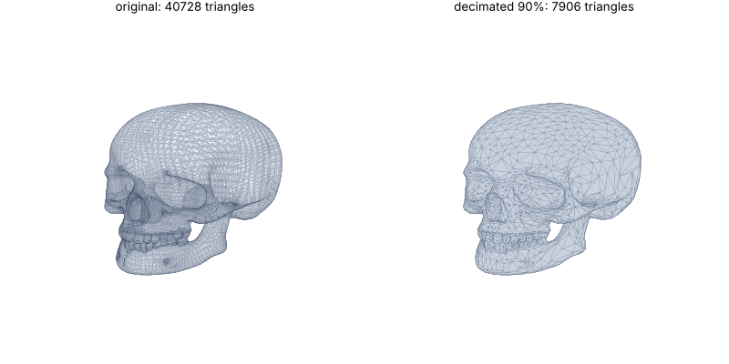

# Mesh Decimator

A Java desktop tool that simplifies 3D triangle meshes using **quadric error metrics** (Garland & Heckbert, 1997). Load an `.obj` model, choose how much detail to remove, preview the result in a 3D viewer and export the simplified mesh. It also has a command-line mode for batch processing.



*Skull model: 40,728 triangles → 7,906 triangles at 90% decimation.*

## How it works

1. **Quadrics per vertex.** Each triangle defines a plane. Its plane equation becomes a 4×4 error quadric, which is summed into the triangle's three vertices. A vertex's quadric measures how far a point is from all the planes it originally touched.
2. **Edge-collapse costs.** For every edge, the quadrics of its two endpoints are added. The new vertex position minimises that combined error, falling back to the edge midpoint when the system has no stable solution. The error at that position is the cost of collapsing the edge.
3. **Greedy collapse.** All candidate collapses go into a min-heap (`PriorityQueue`) ordered by cost. The cheapest edge is collapsed first, adjacent triangles are updated through a vertex-to-face map, collapsed triangles are dropped, and new collapse candidates for the merged vertex go back into the heap. Outdated heap entries are skipped using per-vertex version numbers. This repeats until the target vertex count is reached.

## Features

- Load and export Wavefront `.obj` files (polygon faces are triangulated on load)
- Decimation slider (0–100% of vertices removed) with a live vertex count
- Orbit viewer: drag to rotate, scroll to zoom
- Reload the original mesh to try a different level
- Command-line mode that processes a single file or every `.obj` in a folder
- Sample models included: human figure, skull, sword and car

## Requirements

- Java 17 or newer (`java -version` to check)
- Maven, only if you build from source

## Running

### GUI

```bash
java -jar MeshDecimator.jar
```

Opens the viewer with the sample human mesh. Use **Load** for your own `.obj` file.

GUI with options:

```bash
java -jar MeshDecimator.jar --gui -i model.obj -p 80
```

### Command line

```bash
java -jar MeshDecimator.jar -i <input.obj | folder> -p <percentage 1-99> -o <output.obj | folder>
```

`-p` is the percentage of vertices to remove. Pointing `-i` at a folder decimates every `.obj` in it and writes `<name>_decimated.obj` files to the output folder.

```bash
java -jar MeshDecimator.jar -i MD/src/main/resources/skull.obj -p 90 -o out/
```

## Building from source

```bash
cd MD
mvn compile exec:java              # build and start the GUI
```

Or compile directly into a runnable jar:

```bash
cd MD
mkdir -p build/classes
javac --release 17 -d build/classes $(find src/main/java -name "*.java")
cp src/main/resources/*.obj build/classes/
printf "Main-Class: com.mycompany.md.MD\n" > build/manifest.txt
jar cfm MeshDecimator.jar build/manifest.txt -C build/classes .
```

## Project structure

```
MD/src/main/java/
├── simplify/      QEMUtils (heap and collapse loop), Quadric, EdgeCollapse, Decimate (batch runner)
├── mesh/          Mesh, Vertex, Edge, Face, vec3d, vec4d
├── io/            OBJ loading and export
├── FrameViewer/   Swing UI: DecimatorUI, OrbitViewer, WireframeViewer
├── cli/           Command-line argument handling
└── com/mycompany/md/MD.java   Entry point
```

## Background and credits

Built in 2025 as the group assignment for **Software Design (2IRR00)** at Eindhoven University of Technology, team 39.

- **Alexandru Pirjolescu** ([@alexpirjolescu](https://github.com/alexpirjolescu)): mesh data structures, quadric error metric decimation, Swing UI, command-line mode and OBJ export
- **@v-baranov-tue**: OBJ loader improvements and support for polygon faces
- **@miki252**: export button prototype
- The rest of team 39 worked on unit tests, the 3D engine and UI presets on the team's other branches.

## Reference

M. Garland and P. S. Heckbert, "Surface Simplification Using Quadric Error Metrics", *SIGGRAPH 1997*.
